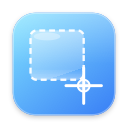
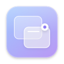
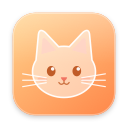
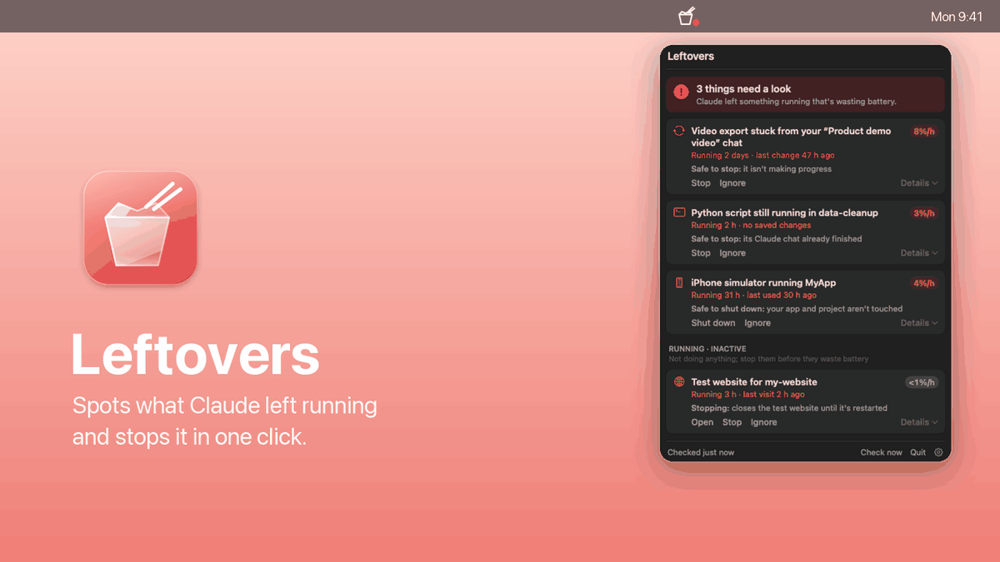
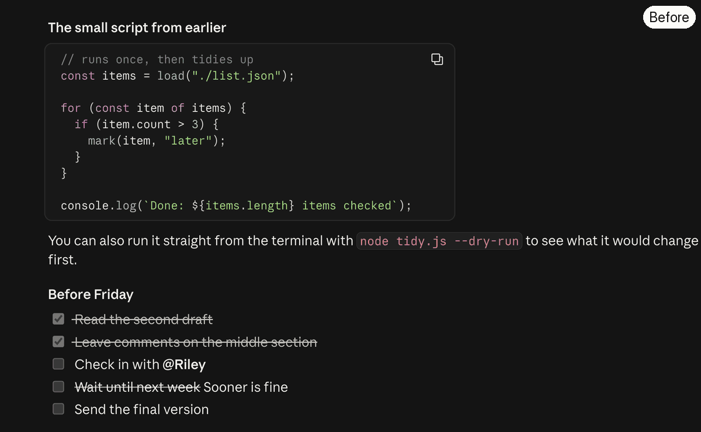
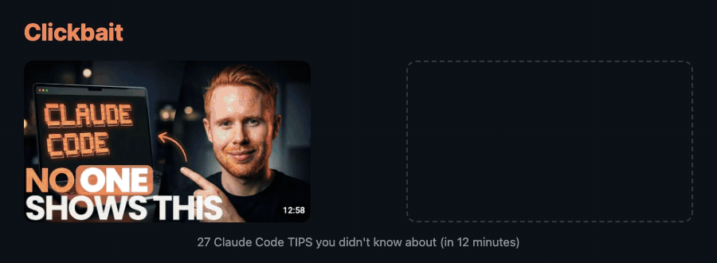
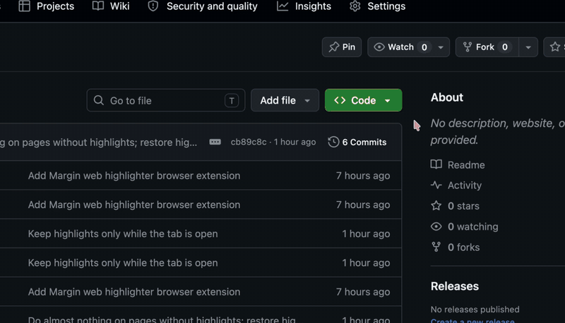
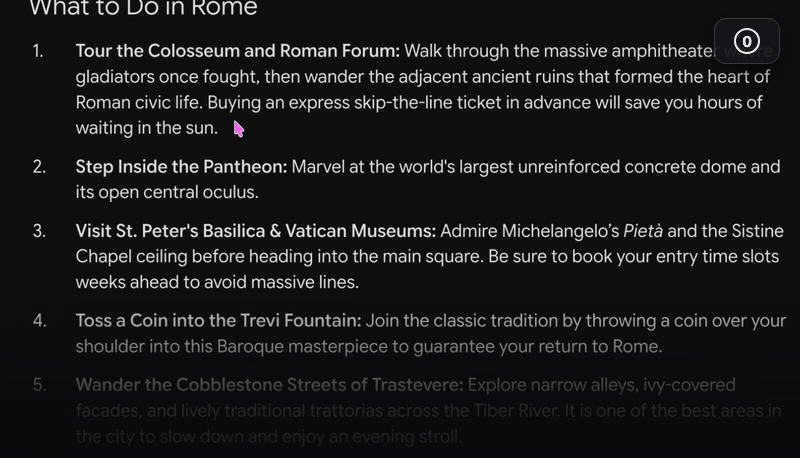
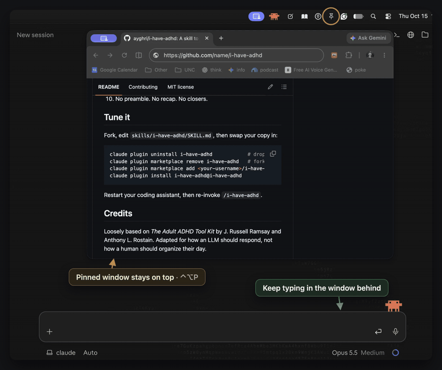

# Hi 👋 I'm making things

## 🖥️ Mac apps

| App | |
|---|---|
|  **[Leftovers](https://github.com/hi-dad/leftovers)** Spots things Claude left running and draining your battery, and stops them in one click. | [⬇️&nbsp;Download](https://github.com/hi-dad/leftovers/releases/latest/download/Leftovers.dmg) macOS 14+ |
|  **[Paperlight](https://github.com/hi-dad/paperlight)** Paper-like display across your entire MacBook. | [⬇️&nbsp;Download](https://github.com/hi-dad/paperlight/releases/latest/download/Paperlight.dmg) macOS 13+ |
|  **[Shelfie](https://github.com/hi-dad/shelfie)** Persistent window to drag & drop your recent screenshots. | [⬇️&nbsp;Download](https://github.com/hi-dad/shelfie/releases/latest/download/Shelfie.dmg) macOS 26+ |
|  **[Jot](https://github.com/hi-dad/jot)** Hold a key, type or talk, and it lands as a bullet in Apple Notes. | [⬇️&nbsp;Download](https://github.com/hi-dad/jot/releases/latest/download/Jot.dmg) macOS 13+ |
|  **[Copy Collector](https://github.com/hi-dad/copy-collector)** ⌘C several things while you read, then paste them all with one ⌘V. | [⬇️&nbsp;Download](https://github.com/hi-dad/copy-collector/releases/latest/download/CopyCollector.dmg) macOS 13+ |
|  **[Window Pane Relief](https://github.com/hi-dad/window-pane-relief)** Pin any window on top of everything and keep working in both. | [⬇️&nbsp;Download](https://github.com/hi-dad/window-pane-relief/releases/latest/download/WindowPaneRelief.dmg) macOS 13+ |
|  **[Desktop Cat](https://github.com/hi-dad/desktop-cat)** A pixel-art cat that lives on your desktop: walks, naps, plays with yarn and perches on your windows. | [⬇️&nbsp;Download](https://github.com/hi-dad/desktop-cat/releases/latest/download/DesktopCat.dmg) macOS 14+ |

Free, for Apple Silicon and Intel Macs. Each download is always the newest version. The first time you open one, macOS says it can't verify the app: go to **System Settings → Privacy & Security** and click **Open Anyway** (once per app). Each app's page has step-by-step install help.

# 🥡 Leftovers

# 📖 Paperlight

# 📸 Shelfie

# 🎯 Bait and Switch

# ✏️ Jot

# 📋 Copy Collector

# 📌 Window Pane Relief

# 🐈 Desktop Cat

## 🌐 Browser

| | |
|---|---|
| **[Bait and Switch](https://github.com/hi-dad/bait-and-switch)** | Swaps YouTube's clickbait thumbnails for real frames from the video. |
