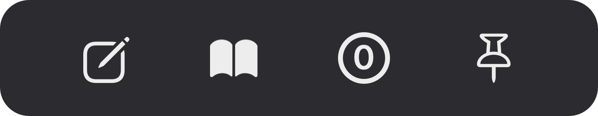
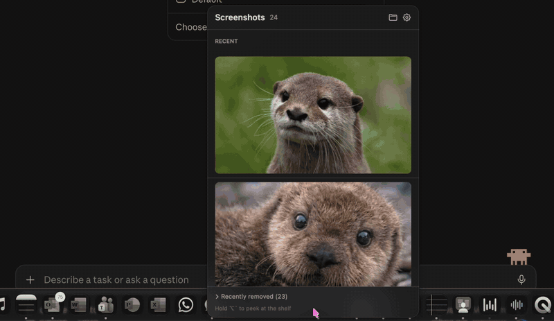
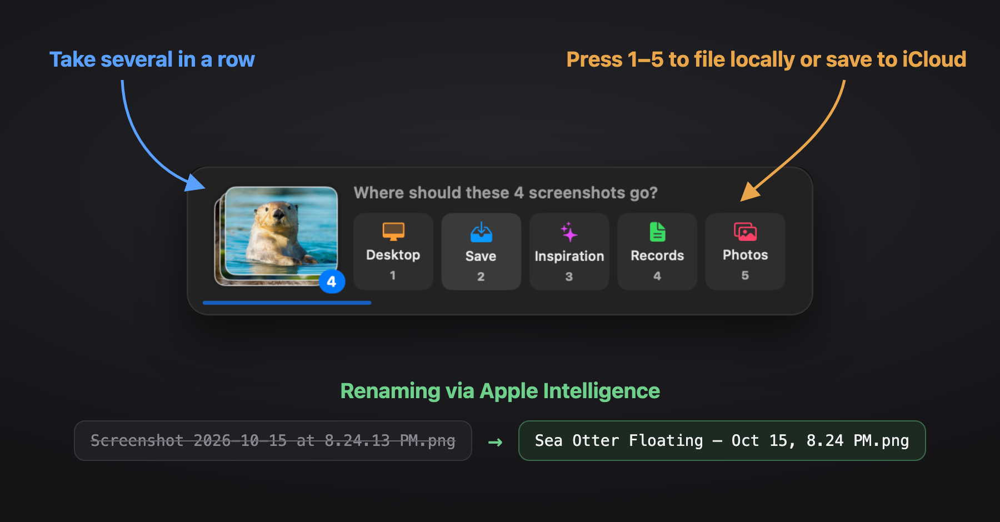

# Hi, I'm Daniel 👋 Im making things

## 🖥️ Mac apps

| | |
|---|---|
| **[Reader Mode](https://github.com/dsryan8197/reader-mode)** | Paper-like display across your entire MacBook. [⬇️ Download](https://github.com/dsryan8197/reader-mode/releases/latest/download/ReaderMode.dmg) |
| **[QuickNote](https://github.com/dsryan8197/quick-paste)** | Hold a key, type or talk, and it lands as a bullet in Apple Notes. [⬇️ Download](https://github.com/dsryan8197/quick-paste/releases/latest/download/QuickNote.dmg) |
| **[Clip List](https://github.com/dsryan8197/clip-list)** | ⌘C several things while you read, then paste them all with one ⌘V. |
| **[Screenshot Dock](https://github.com/dsryan8197/screenshot-dock)** | Persistent window to drag & drop your recent screenshots. |
| **[Window Pin](https://github.com/dsryan8197/window-pin)** | Pin any window on top of everything and keep working in both. |

### 📖 Reader Mode

### ✏️ QuickNote

### 📋 Clip List

### 📸 Screenshot Dock

## 🌐 Browser

| | |
|---|---|
| **[Scribbly](https://github.com/dsryan8197/scribbly)** | Highlight and annotate any web page; copy your notes out as Markdown. |
| **[not-loom](https://github.com/dsryan8197/not-loom)** | Loom-style screen + camera-bubble recorder that runs locally. No account, no uploads. |

## 🎮 Games

| | |
|---|---|
| **[Puzzle Table](https://github.com/dsryan8197/puzzles)** | Turn your own photos into 24–1000 piece jigsaws, on iPhone or Mac. |
| **[ZOM-ZOM](https://github.com/dsryan8197/zom-zom)** | Blocky, foggy small-town zombie wave shooter in the browser (Three.js). |
