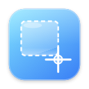
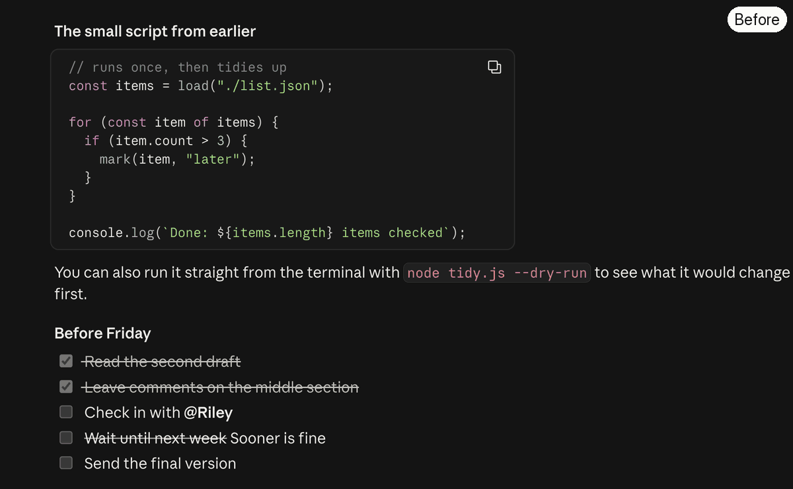
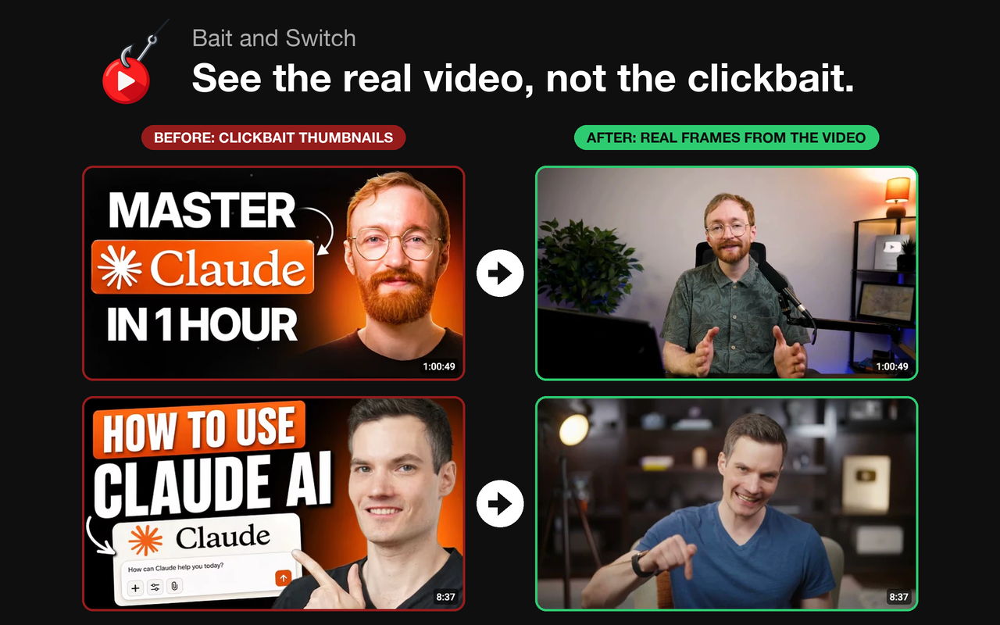
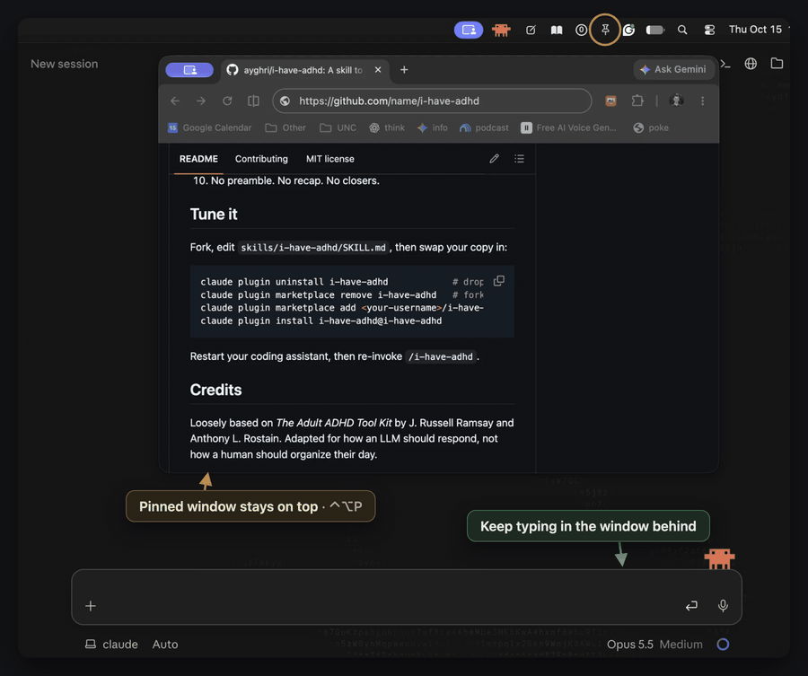
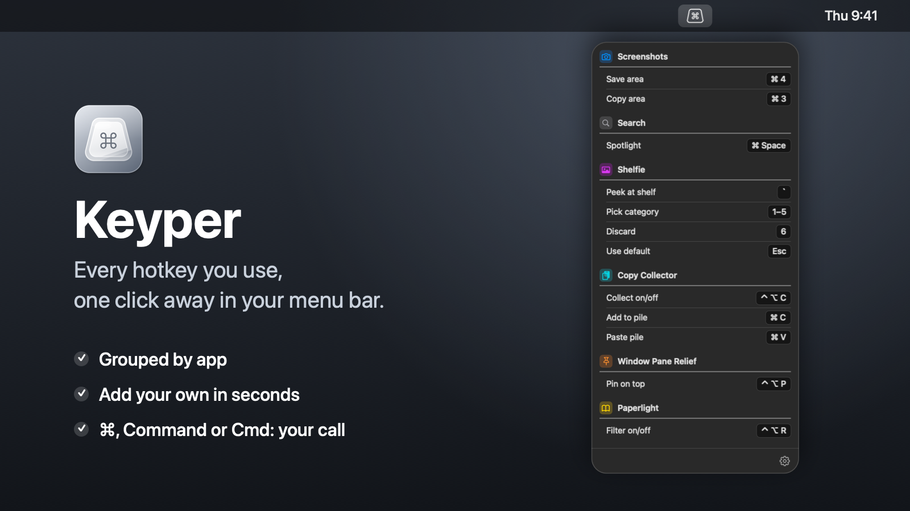
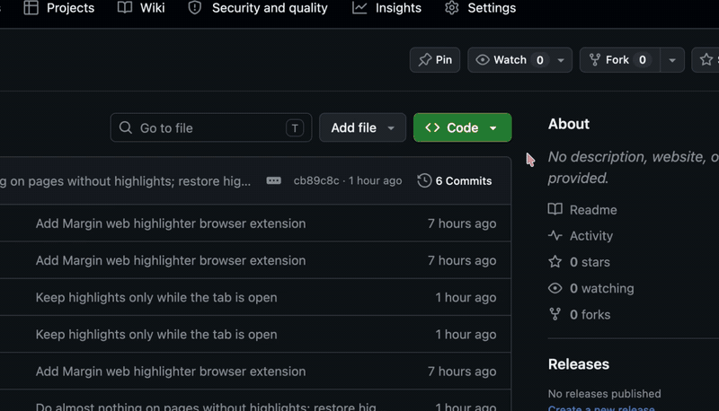
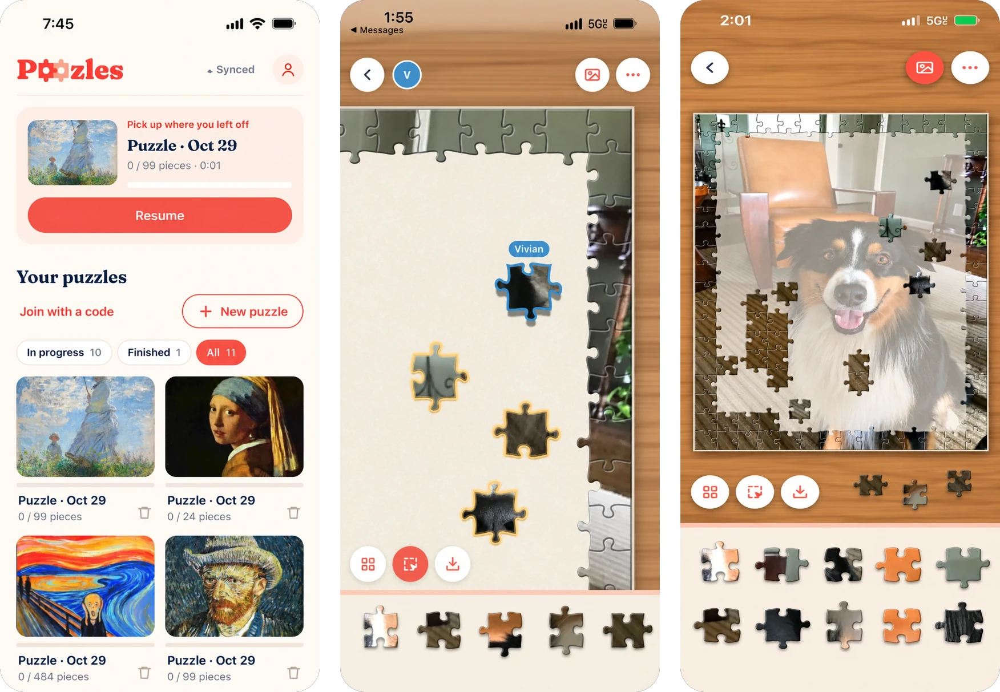
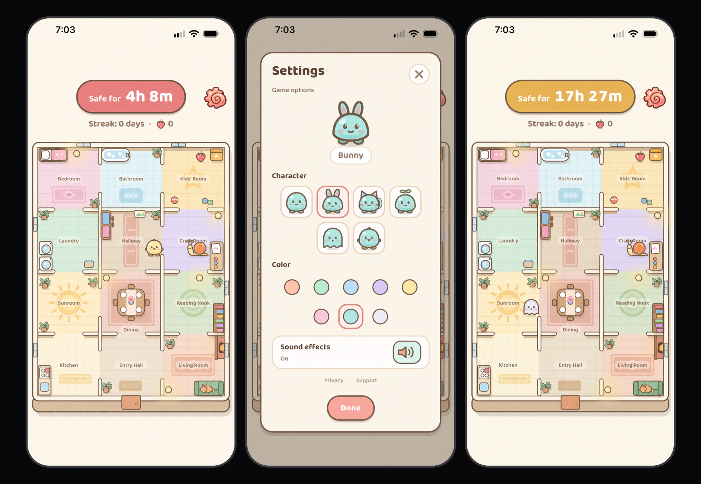

# Hi 👋 I'm making things

## 🖥️ Apps

| App | |
|---|---|
|  **[Leftovers](https://github.com/hi-dad/leftovers)** Spots things Claude left running and draining your battery, and stops them in one click. | [⬇️&nbsp;Download](https://github.com/hi-dad/leftovers/releases/latest/download/Leftovers.dmg) macOS 14+ |
|  **[Paperlight](https://github.com/hi-dad/paperlight)** Paper-like display across your entire MacBook. | [⬇️&nbsp;Download](https://github.com/hi-dad/paperlight/releases/latest/download/Paperlight.dmg) macOS 13+ |
|  **[Shelfie](https://github.com/hi-dad/shelfie)** Persistent window to drag & drop your recent screenshots. | [⬇️&nbsp;Download](https://github.com/hi-dad/shelfie/releases/latest/download/Shelfie.dmg) macOS 26+ |
|  **[Desktop Cat](https://github.com/hi-dad/desktop-cat)** A pixel-art cat that lives on your desktop: walks, naps, plays with yarn and perches on your windows. | [⬇️&nbsp;Download](https://github.com/hi-dad/desktop-cat/releases/latest/download/DesktopCat.dmg) macOS 14+ |
|  **[Jot](https://github.com/hi-dad/jot)** Hold a key, type or talk, and it lands as a bullet in Apple Notes. | [⬇️&nbsp;Download](https://github.com/hi-dad/jot/releases/latest/download/Jot.dmg) macOS 13+ |
|  **[Copy Collector](https://github.com/hi-dad/copy-collector)** ⌘C several things while you read, then paste them all with one ⌘V. | [⬇️&nbsp;Download](https://github.com/hi-dad/copy-collector/releases/latest/download/CopyCollector.dmg) macOS 13+ |
|  **[Window Pane Relief](https://github.com/hi-dad/window-pane-relief)** Pin any window on top of everything and keep working in both. | [⬇️&nbsp;Download](https://github.com/hi-dad/window-pane-relief/releases/latest/download/WindowPaneRelief.dmg) macOS 13+ |
|  **[Keyper](https://github.com/hi-dad/keyper)** Every hotkey you use, one click away in your menu bar, grouped by app. | [⬇️&nbsp;Download](https://github.com/hi-dad/keyper/releases/latest/download/Keyper.dmg) macOS 14+ |
|  **[Bait and Switch](https://github.com/hi-dad/bait-and-switch)** Swaps YouTube's clickbait thumbnails for real frames from the video. | [⬇️&nbsp;Install](https://chromewebstore.google.com/detail/bait-and-switch-replace-y/khjokdeamjlfoiobknbgbmohdfgpcdof) Chrome |
|  **[Poozles](https://github.com/hi-dad/poozles)** Turn any photo into a jigsaw and solve it with friends. | [▶️&nbsp;Play](https://poozles.app) Web |
|  **[Snail House](https://github.com/hi-dad/snail-house)** A slow-burn survival game about staying one step ahead of a very persistent snail. | [📱&nbsp;Download](https://apps.apple.com/us/app/snail-house/id6826937107) iOS |

Free. The Mac apps run on Apple Silicon and Intel Macs. Each download is always the newest version. They're signed and checked by Apple, so the first time you open one, just click **Open** when macOS asks if you're sure. Each app's page has step-by-step install help.

# 🥡 Leftovers

# 📖 Paperlight

# 📸 Shelfie

# 🐈 Desktop Cat

# 🎯 Bait and Switch

# 📌 Window Pane Relief

# ⌨️ Keyper

# ✏️ Jot

# 📋 Copy Collector

# 🧩 Poozles

# 🐌 Snail House

